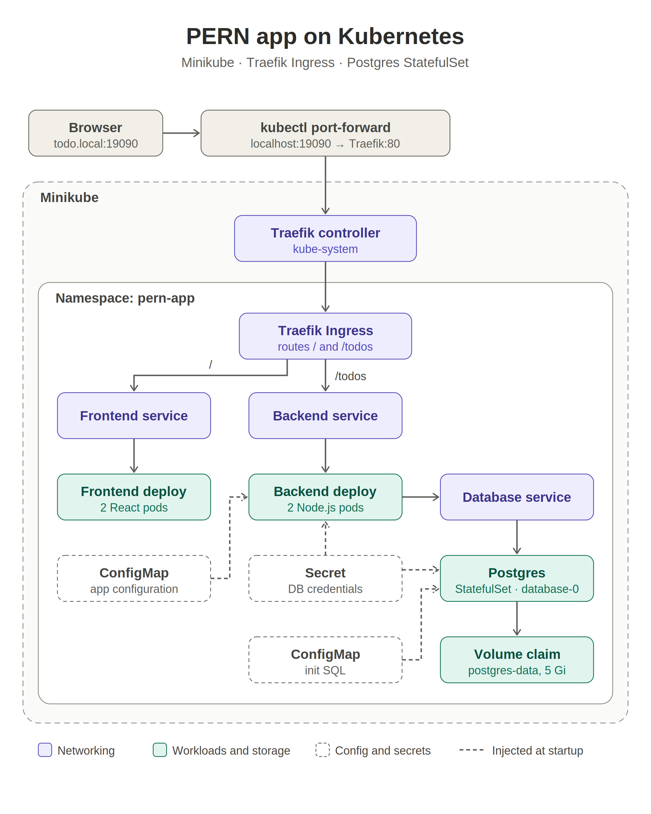

# PERN Todo App on Kubernetes

A Todo application built with PostgreSQL, Express, React, and Node.js (PERN), packaged as containers and deployed to Kubernetes with Helm.

## Architecture



The Helm chart deploys the frontend and backend in the `pern-app` namespace. Traefik Ingress routes `/` to the frontend and `/todos` to the backend. PostgreSQL runs as a StatefulSet and stores data on a persistent volume claim.

## Prerequisites

- Docker
- Minikube
- `kubectl`
- Helm

The commands below use Bash (for example, WSL).

## Deploy locally with Minikube

From the repository root, start Minikube and enable its Traefik addon:

```bash
minikube start
minikube addons enable traefik
```

Build the application images inside Minikube:

```bash
minikube image build -t pern-backend:latest -f dockerfile .
minikube image build -t pern-frontend:latest -f client/apache.dockerfile client
```

Create the namespace and a Kubernetes Secret for database credentials. Choose a password and keep it private; enter that same password when PostgreSQL is initialized.

```bash
kubectl apply -f pern-k8s/namespace.yaml

read -r -s -p "Database password: " DB_PASSWORD
echo
kubectl create secret generic database-credentials-external \
  --namespace pern-app \
  --from-literal=POSTGRES_USER=todo_user \
  --from-literal=POSTGRES_PASSWORD="$DB_PASSWORD" \
  --from-literal=POSTGRES_DB=todos \
  --from-literal=PG_USER=todo_user \
  --from-literal=PG_PASSWORD="$DB_PASSWORD"
unset DB_PASSWORD
```

Install the application with Helm:

```bash
helm lint pern-k8s/helm/pern-app
helm upgrade --install pern-app pern-k8s/helm/pern-app --namespace pern-app
kubectl get pods,services,pvc,ingress -n pern-app
```

Wait until the frontend, backend, and database pods are Ready. The database Secret is created separately and is referenced by the chart; credentials are not stored in `values.yaml`.

## Open the app

Add this line to the Windows hosts file (`C:\Windows\System32\drivers\etc\hosts`), editing it as Administrator:

```text
127.0.0.1 todo.local
```

In a WSL terminal, start a port-forward and leave it running:

```bash
kubectl port-forward -n kube-system svc/traefik 19090:80
```

Open <http://todo.local:19090/> in a browser. The API is available at <http://todo.local:19090/todos>.

## Useful commands

```bash
kubectl get pods,services,pvc,ingress -n pern-app
kubectl logs deployment/backend -n pern-app --tail=50
helm status pern-app -n pern-app
```
